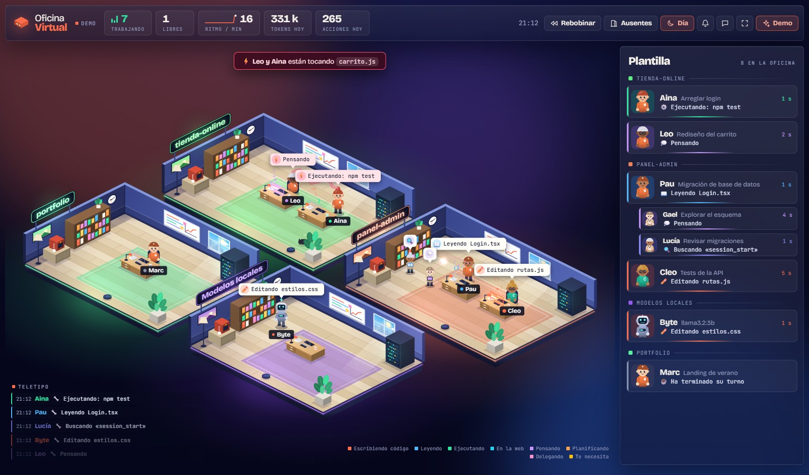
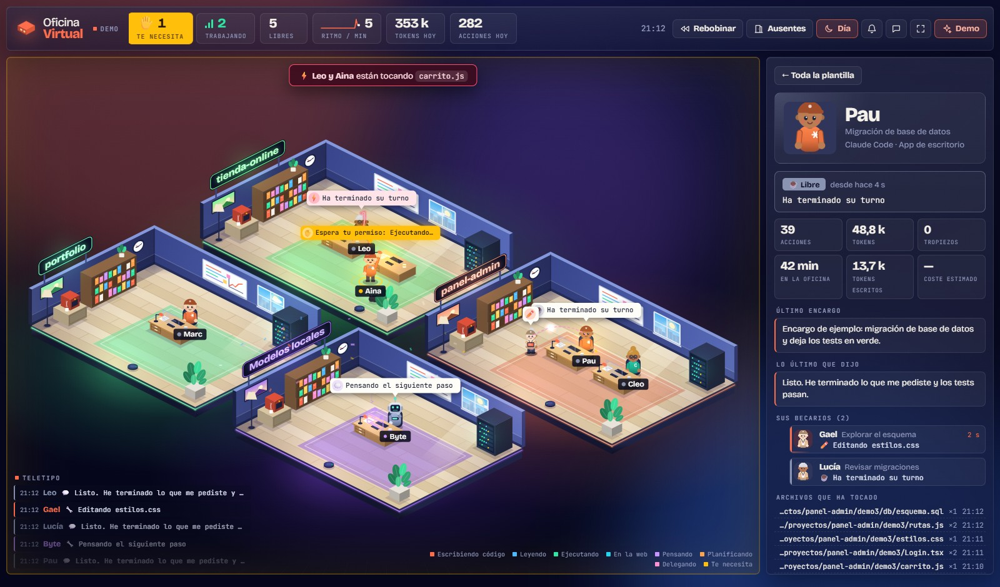
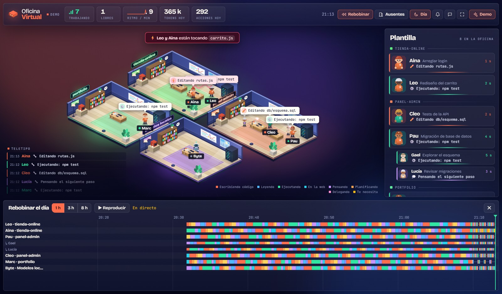
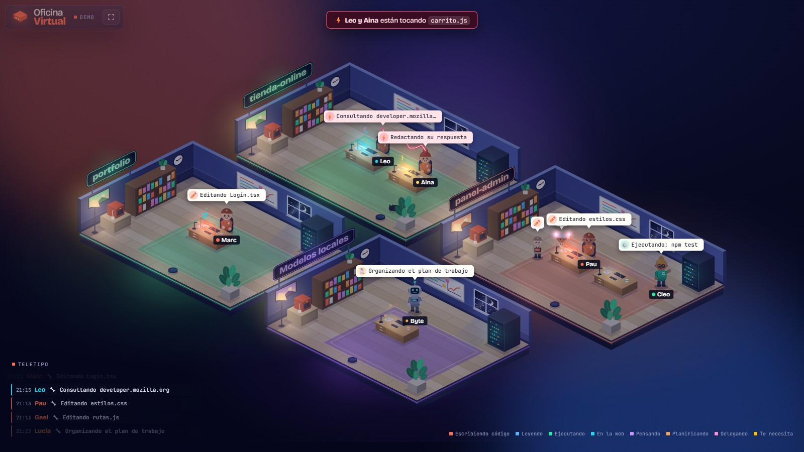
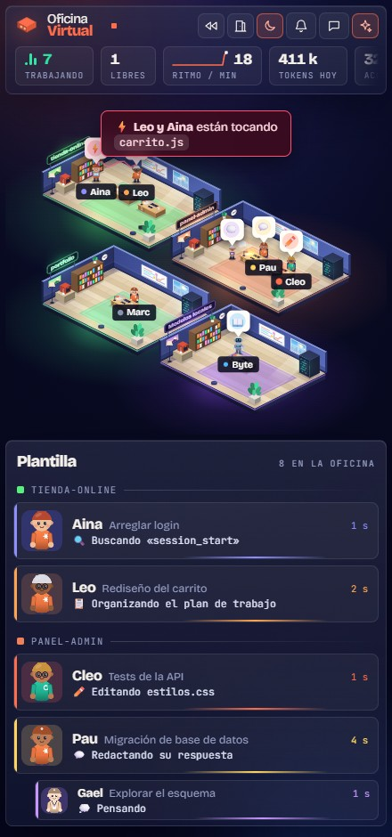
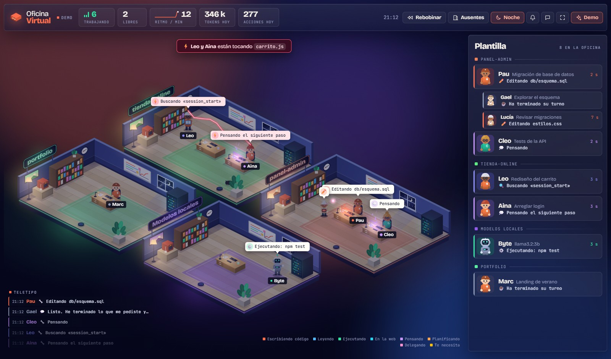

<div align="center">

# Oficina Virtual

**Tus agentes de IA, convertidos en compañeros de oficina.**

Una oficina isométrica en directo donde cada agente que trabaja en tu PC es un trabajador:
ves quién teclea, quién lee, quién ejecuta comandos y, sobre todo, **quién está parado esperándote**.




</div>

## Qué es

Cuando tienes varios agentes programando a la vez, lo normal es ir saltando de ventana en ventana para saber qué hace cada uno y cuál se ha quedado bloqueado pidiéndote permiso. Oficina Virtual lo pone todo en una sola pantalla que puedes dejar abierta a un lado:

- **Cada proyecto es una sala** y **cada agente, un trabajador** con nombre y aspecto propios.
- Se mueven según lo que hacen de verdad: teclean, van a la estantería, al armario de servidores, a la pizarra…
- Cuando uno te necesita, **se levanta, alza la mano y la oficina te avisa**.

No instala nada, no necesita base de datos y **solo lee**: nunca toca tus agentes ni sus archivos.

## Empezar

Necesitas [Node.js](https://nodejs.org) 18 o superior. Nada más.

```bash
git clone https://github.com/rochydev/oficina-virtual.git
```

```bash
cd oficina-virtual
```

```bash
node server.js --abrir
```

Se abre en <http://localhost:4317>. En Windows también puedes hacer doble clic:

| Quiero… | Doble clic en… |
|---|---|
| La oficina a pantalla normal | `iniciar.bat` |
| Una ventana estrecha para dejar a un lado de la pantalla | `iniciar-lateral.bat` |

¿No tienes ningún agente abierto ahora mismo? Pulsa **Demo** (o arranca con `node server.js --abrir --demo`) y la oficina se llena de agentes de ejemplo.

Para apagarla, cierra la terminal o pulsa `Ctrl + C`.

## Qué agentes aparecen

Los detecta sola, sin configurar nada, en uno o dos segundos:

| Origen | De dónde se lee | Cómo se ve |
|---|---|---|
| **Claude Code** (terminal, app de escritorio, IDE) | `~/.claude/projects` y `~/.claude/sessions` | Jersey naranja |
| **Subagentes** que lanza una sesión | Carpeta `subagents` de cada sesión | Becarios más pequeños, con acreditación, unidos por un hilo a quien los lanzó |
| **Codex** (CLI o VS Code) | `~/.codex/sessions` | Jersey verde |
| **Ollama** (modelos locales cargados) | `http://127.0.0.1:11434` | Robots |

## Cómo leer la oficina

| El trabajador… | El agente está… |
|---|---|
| Teclea en su mesa | Editando archivos o redactando su respuesta |
| Va a la estantería con un libro | Leyendo o buscando en el código |
| Va al armario de servidores | Ejecutando comandos |
| Va a la pizarra | Organizando su plan |
| Se lleva la mano a la barbilla | Pensando |
| **Se pone de pie delante de la mesa con la mano levantada** | **Esperando tu permiso o tu respuesta** |
| Se toma un café junto a la máquina | Libre: terminó su turno |

La pantalla holográfica de cada mesa y el punto junto al nombre toman el color de la actividad:

| | | | |
|---|---|---|---|
| 🟧 Escribiendo código | 🟦 Leyendo | 🟩 Ejecutando | 🟪 Pensando |
| 🟨 Respondiendo | 🟫 Planificando | 🩷 Delegando | 🟡 **Te necesita** |

## Funciones

### Ficha de cada agente

Haz clic en un trabajador (o en su tarjeta de la lista) para ver su último encargo, lo último que dijo, los archivos que ha tocado, su actividad reciente, tokens, becarios y un botón para abrir su carpeta.



### Rebobinar el día

Una línea de tiempo por agente de la última 1, 3 u 8 horas. Arrastra para ver la oficina **tal como estaba en ese momento**, o pulsa «Reproducir» para verla pasar a un minuto por segundo.



### Choques entre agentes

Si dos agentes tocan el mismo archivo en menos de 10 minutos, salta un rayo entre ellos y aparece un aviso arriba con el nombre del archivo (se ve en la captura anterior). Es la forma más rápida de pillar a dos agentes pisándose el trabajo.

### Día, noche y modo cine

Las ventanas y la luz siguen la hora real; de noche se encienden los flexos, las pantallas y los rótulos. Con el botón de la luna puedes forzar «Día» o «Noche», y con la tecla `F` entras en **modo cine**: solo la oficina, sin paneles.



### Modo lateral

Al estrechar la ventana, la oficina queda arriba y la plantilla debajo: pensado para tenerla pegada a un lado mientras trabajas. `iniciar-lateral.bat` la abre ya con ese tamaño.

<p align="center"></p>

### Y además

- **Avisos** con sonido cuando alguien te necesita o termina, y un marco ámbar alrededor de la oficina. El botón de avisos de escritorio te lo notifica aunque estés en otra ventana, y la pestaña muestra `(2 ✋)` en el título.
- **Teletipo**: abajo a la izquierda, lo último que ha hecho cada agente, en directo.
- **Ritmo**: gráfica en la barra superior con las acciones del último minuto, junto a los tokens y acciones del día.
- **Bocadillos con lo que hace de verdad**: el archivo que edita, el comando que ejecuta, lo que busca.
- **Ausentes**: muestra en la lista las sesiones de las últimas horas que ya no están activas.
- **Detalles vivos**: confeti cuando alguien termina, reloj de pared con la hora real, robot aspirador y el gato de la oficina.



## Controles

| Acción | Cómo |
|---|---|
| Moverse por la oficina | Arrastrar |
| Acercar o alejar | Rueda del ratón (hacia el cursor) |
| Recolocar la vista | Doble clic |
| Abrir la ficha de un agente | Clic en el trabajador o en su tarjeta |
| Cerrar la ficha / volver al directo | `Esc` |
| Modo cine | `F` |

## Opciones

### Al arrancar

| Opción | Qué hace |
|---|---|
| `--abrir` | Abre la oficina en el navegador |
| `--lateral` | La abre como ventana estrecha (usa Microsoft Edge en modo aplicación) |
| `--demo` | Añade agentes de ejemplo a los reales |
| `--solo-demo` | Solo agentes de ejemplo: no lee ninguno real. Útil para enseñarla o hacer capturas |

El puerto también se puede cambiar con la variable de entorno `PORT`.

### En la dirección

Puedes abrir la oficina ya en una vista concreta añadiendo opciones a la URL, por ejemplo `http://localhost:4317/?ambiente=noche&cine`:

| Opción | Qué hace |
|---|---|
| `ambiente=dia` / `ambiente=noche` | Fuerza el ambiente |
| `cine` | Entra en modo cine |
| `rebobinar` | Abre la línea de tiempo |
| `ficha=Nombre` | Abre la ficha del trabajador con ese nombre |

### `config.json`

| Clave | Para qué | Por defecto |
|---|---|---|
| `puerto` | Puerto local | `4317` |
| `ventanaHoras` | Cuántas horas atrás se recuerdan sesiones ya cerradas | `8` |
| `fuentes` | Activar o desactivar `claude`, `codex`, `ollama` | todas activas |
| `ollamaUrl` | Dirección de Ollama | `http://127.0.0.1:11434` |
| `precios` | Opcional: precio por millón de tokens de cada modelo, para ver un coste estimado | vacío |

Sin precios, la oficina muestra solo tokens (no se inventa cifras). Para ver el coste, pon los precios reales de tu plan; la clave es un trozo del nombre del modelo:

```json
"precios": {
  "opus":   { "entrada": 0, "salida": 0, "cacheLectura": 0, "cacheEscritura": 0 },
  "sonnet": { "entrada": 0, "salida": 0, "cacheLectura": 0, "cacheEscritura": 0 }
}
```

## Privacidad y seguridad

- **Solo lectura.** Lee los registros que los agentes ya escriben en tu disco; no los modifica ni les envía nada.
- **Solo en tu equipo.** El servidor escucha únicamente en `127.0.0.1` y rechaza peticiones de otros orígenes, porque la página muestra fragmentos de tus conversaciones.
- **Nada sale de tu PC.** No hay telemetría ni servicios externos. Lo único que se pide a internet son las tipografías de la página (Google Fonts); sin conexión funciona igual con las del sistema.

## Cómo funciona

```
 registros de los agentes ──▶  server.js  ──▶  navegador
 (~/.claude, ~/.codex,         lee solo lo      dibuja la oficina
  API local de Ollama)         nuevo cada 1 s   en un <canvas>
```

Un servidor Node sin dependencias sigue los archivos de registro de cada agente (solo lo que se va añadiendo), deduce de ahí el estado y la actividad de cada uno, y envía una foto completa al navegador por *Server-Sent Events*. La página dibuja la oficina con Canvas 2D: no hay ni una imagen, todo se pinta con código.

```
server.js          servidor web, API y envío en directo
lib/claude.js      lector de Claude Code y sus subagentes
lib/codex.js       lector de Codex
lib/ollama.js      lector de Ollama
lib/demo.js        agentes de ejemplo
lib/util.js        utilidades comunes (seguimiento de archivos, descripción de acciones)
public/office.js   dibujo de la oficina isométrica
public/app.js      lista, fichas, avisos, teletipo y línea de tiempo
public/style.css   aspecto de la interfaz
config.json        ajustes
```

| Ruta | Qué devuelve |
|---|---|
| `GET /api/stream` | Estado en directo (Server-Sent Events) |
| `GET /api/state` | El estado actual, una sola vez |
| `GET /api/timeline?h=3` | Historial de las últimas horas para rebobinar |
| `POST /api/demo` | Enciende o apaga los agentes de ejemplo |
| `POST /api/open` | Abre la carpeta de un agente en el explorador |

## Límites que conviene saber

- **«Te necesita» es en parte una deducción.** Las preguntas y la aprobación de planes se detectan con certeza. Los permisos se deducen: si una acción que debería ser instantánea (editar, leer) lleva más de 10 segundos sin resultado, se asume que espera tu permiso. Un comando de terminal que pide permiso no se distingue de uno que simplemente tarda.
- **Ollama** solo informa de qué modelos están cargados, no de lo que escriben. Su actividad se estima.
- **Codex** no publica qué sesiones siguen abiertas: se considera presente si ha escrito algo en los últimos 15 minutos.
- Los lanzadores `.bat` y el modo `--lateral` son para Windows; en macOS y Linux usa `node server.js --abrir`.

## Licencia

[MIT](LICENSE)
